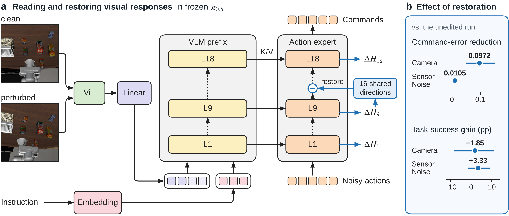

# Sensitivity Is Not Fragility
**Shared Visual Responses and Task Outcomes in Vision-Language-Action Policies**

[Paper](paper1/current/latex/main.pdf) · [Supplement](paper1/current/latex/supplement.pdf) · [Illustrated guide](docs/figures/README.md) · [中文逐图讲解](docs/figures/README.zh-CN.md) · [组会讲义 (PDF)](docs/figures/group-meeting-zh.pdf)

Under sensor noise, a π₀ robot moves only **0.58×** as far from its clean trajectory in the first five controls as two clean runs move from each other. Yet its task success falls by **14.3 percentage points**. What can a change in a robot’s visual input tell us about its actions and its chances of success?

We study frozen π₀.₅ and π₀ policies on LIBERO and LIBERO-Plus. In π₀.₅, different visual perturbations produce feature changes along shared directions. Restoring the clean values along 16 of those directions brings the issued commands closer to their clean references. Independent paired executions show which successful runs are lost and which failed runs become successes.



## Read the figures

| Question | Where to look |
|---|---|
| Where do we record the visual response? What stays fixed between two runs? | **Figures 1–2, Table 1.** Follow one observation through generation and execution, then compare the three paired study designs. |
| Do the same feature directions describe responses to unseen tasks and perturbations? | **Figure 3.** Sixteen directions retain **36.5–83.6%** of held-out residual response energy. The second panel asks how well those coordinates predict translation commands. |
| Does changing those features change what the robot does? | **Figure 4, Table 2.** Restoring clean coordinates reduces initial command error by **24%** under Camera and **5%** under Sensor Noise. The observed success gains have simultaneous intervals that include zero. |
| What can an average success rate hide? | **Figure 5, Table 3.** Under Background, π₀.₅ loses success on 3.57% of pairs and gains it on another 3.57%, with tasks weighted equally. Net success stays unchanged while **7.14%** of paired outcomes flip. |

The illustrated guide shows each panel alongside its comparison, population and link to the underlying data. The 17-slide Chinese talk includes speaker notes in the PowerPoint version. [English guide](docs/figures/README.md) · [中文导读](docs/figures/README.zh-CN.md) · [PowerPoint](docs/figures/group-meeting-zh.pptx)

## Reproduce the main results

Clone the repository and run the numerical check with Python 3.9 or later. The required inputs are included; the check uses only the standard library.

```sh
git clone https://github.com/heeh02/adv-vla-research.git
cd adv-vla-research
git checkout paper-v1.2
python3 -B reproduce/paper.py --output paper-results.json
```

The check rebuilds **112 task rows** for Figure 3, compares the first five issued commands across **216 six-arm cases** for Figure 4, and recomputes Figure 5’s outcomes from the five-arm records. Open `paper-results.json` to inspect group estimates and individual Sensor Noise pairs. The reproduction guide identifies the estimators, uncertainty intervals, archived inputs and commands to rebuild both PDFs. [Reproduction guide](reproduce/README.md) · [Statistical and collection code](paper1/reproduction) · [Download the data](https://github.com/heeh02/adv-vla-research/releases/tag/v1.0.0)

## Two studies we are releasing for others to continue

We originally planned two companion papers. We did not have enough time to pursue them further. We are releasing the drafts, implementations, retained results and open questions so that others can build on the work.

- **Intervention and prediction.** The draft and reassessment document which controlled interventions were executed, the results of the single-window physical pilot and the remaining questions about task-level effects. [Draft](p2/archive/docs/experiments/paper2-independent-session-20261019-v1/manuscript/rss-revision-v11/latex/main.pdf) · [Reassessment](p2/reassessment.md) · [Code](p2/implementation)
- **Training continuation and behavior.** The final report compares continued training with the parent checkpoints on matched settings. It gives the support for each comparison and where the seeds differ. [Draft](p3/archive/docs/experiments/paper3-training-study-20261019-v1/rss-draft-20261021-v1/manuscript/main.pdf) · [Final report](p3/archive/docs/experiments/paper3-training-study-20261019-v1/final-closeout-report-20261022-v1/REPORT.md) · [Code](p3/training)

[Data inventory for the original release](FILES.csv) · [Software, data and figure licenses](LICENSING.md)
