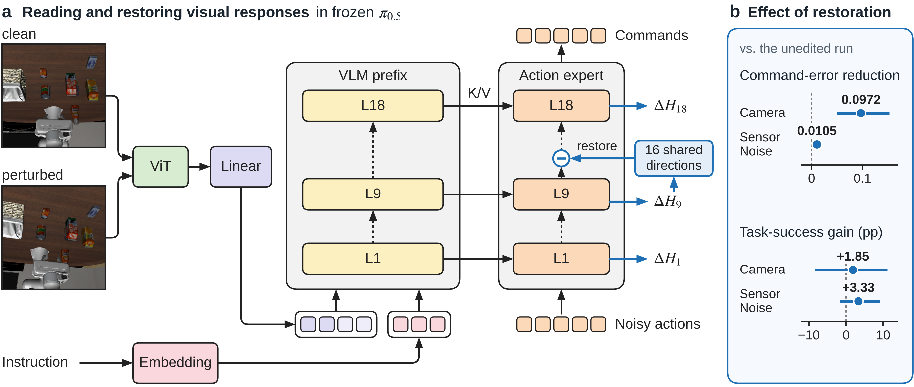
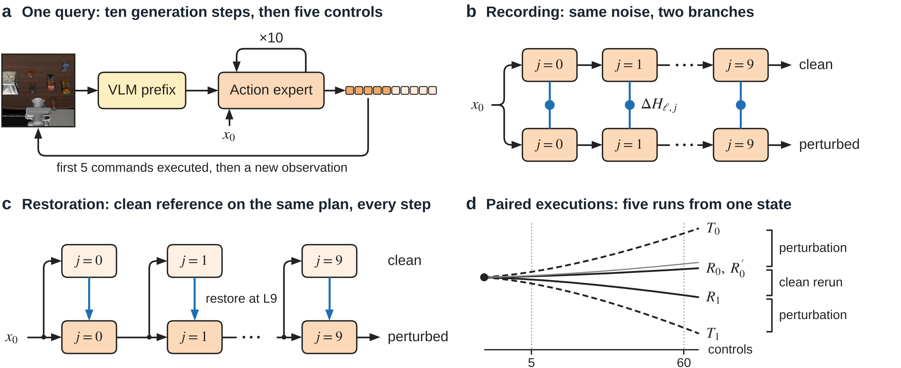
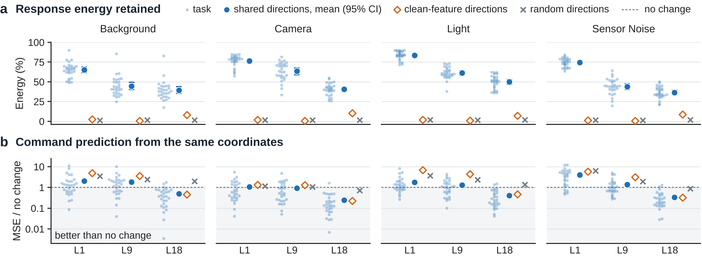
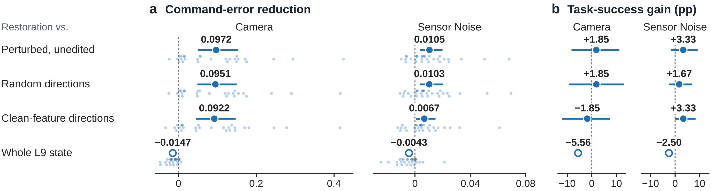
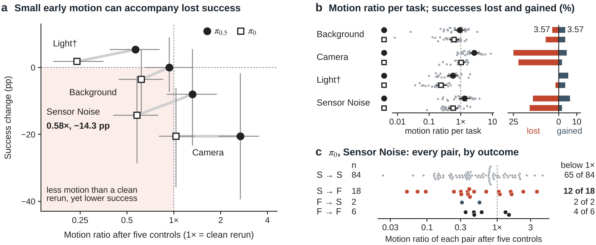

# Reading the five figures in *Sensitivity Is Not Fragility*

[中文逐图讲解](README.zh-CN.md) · [Paper](../../paper1/current/latex/main.pdf) · [Group meeting slides in Chinese (PDF)](group-meeting-zh.pdf) · [PowerPoint with speaker notes](group-meeting-zh.pptx) · [Numerical reproduction guide](../../reproduce/README.md)

## Figure 1 · Where does the visual change reach the policy?

Follow the two observations in panel **a**. They depict the same physical state and share the same policy noise. Subtracting the clean features from the perturbed features after blocks L1, L9 and L18 gives a visual response at each site. The return arrow at L9 shows the intervention. During generation, the experiment copies clean values along 16 learned directions back into the perturbed run.

Panel **b** measures the effect twice. Under Camera, restoration brings the first five commands 24% closer to the clean commands. The observed task success change is +1.85 percentage points, with a simultaneous 95% interval from −8.33 to +11.11. Figure 4 shows how these comparisons vary across tasks and intervention choices. [Paper p. 1](../../paper1/current/latex/main.pdf) · [Talk slides 2 and 7](group-meeting-zh.pdf)

## Figure 2 · What is held fixed in each experiment?

Read **a** for timing. In one query the policy refines an action plan over ten generation updates. The robot executes the first five controls before taking another observation. **b** compares internal features at corresponding generation steps. **c** obtains the clean reference at the perturbed robot’s *current* physical state, so the comparison follows the robot even after its motion changes.

In **d**, compare a perturbed run with the clean run that used the same noise. Then compare the two clean runs with different noise to gauge ordinary sampling variation. Table 1 gives the population for each experiment. [Paper p. 3](../../paper1/current/latex/main.pdf) · [Talk slides 8–9](group-meeting-zh.pdf)

## Figure 3 · Which changes recur, and which help predict a command?

In **a**, the directions are fitted on the training data, then held fixed while each test response supplies its projection coefficients. On 404 pairs across 28 tasks, the 16 response directions retain **36.5–83.6%** of residual energy across layer–family averages. Equal-rank directions fitted to clean features and random directions give the controls. The small dots show how the response result varies by task.

In **b**, a fitted readout predicts the change in the first five translation commands. A value below **1** improves on predicting that the commands stay the same. L1 retains the most response energy in each family, while the tested readout has its lowest translation error at L18. The choice of layer therefore depends on what the reader wants to measure. [Paper p. 5](../../paper1/current/latex/main.pdf) · [Talk slides 10–11](group-meeting-zh.pdf) · [Task scores and provenance](../../reproduce/inputs/)

## Figure 4 · What changes when the shared coordinates are restored?

Each row compares two runs of the same cases. In **a**, a positive contrast means that restoring the shared directions produces commands closer to the clean reference. Against the unedited run, error falls from **0.409 to 0.312** under Camera and **0.209 to 0.199** under Sensor Noise. The small dots give the task-level differences. Read the scale separately for each family.

In **b**, the outcome is success. The corresponding estimates are **+1.85** and **+3.33 percentage points**; both simultaneous intervals include zero. Table 2 also gives the sizes of the edits. Whole-layer replacement is shown with an open mark and has no interval in this figure. The verifier recomputes command error from issued vectors and checks paired outcomes. The six simultaneous contrast intervals are supplied in the archived table. [Paper p. 6](../../paper1/current/latex/main.pdf) · [Talk slides 12–13](group-meeting-zh.pdf) · [Comparison tables](../../paper1/current/figure_src/raw/restoration/)

## Figure 5 · What does a motion difference tell us about success?

In **a**, find π₀ under Sensor Noise. Its mean early motion separation is **0.58×** the distance between two clean runs with different policy noise. Its paired success rate still falls by **14.3 percentage points**. The motion ratio uses a ratio of task-weighted means.

Panel **b** shows what a net rate can hide. For π₀.₅ under Background, losses and gains each account for **3.57%**. Net change is zero, while **7.14%** of paired outcomes flip. In **c**, each of the 110 π₀ Sensor Noise pairs has its own setting’s reference. Of the 18 pairs that change from success to failure, 12 fall below that reference. This panel lets readers inspect the individual outcomes behind the family average. [Paper p. 7](../../paper1/current/latex/main.pdf) · [Talk slides 14–15](group-meeting-zh.pdf) · [Five-arm estimator](../../paper1/current/figure_src/scripts/fig5_data.py)

The slide deck preserves the November 12 group meeting, including the shorter working subtitle on its cover and the meeting checklist on slide 17. The linked paper and reproduction guide describe the repository version.
