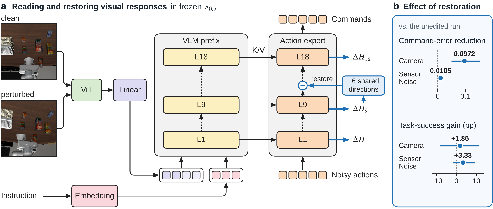
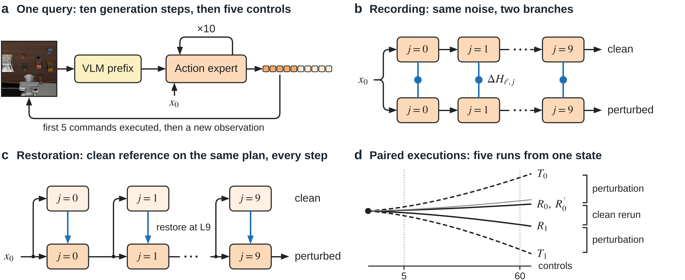
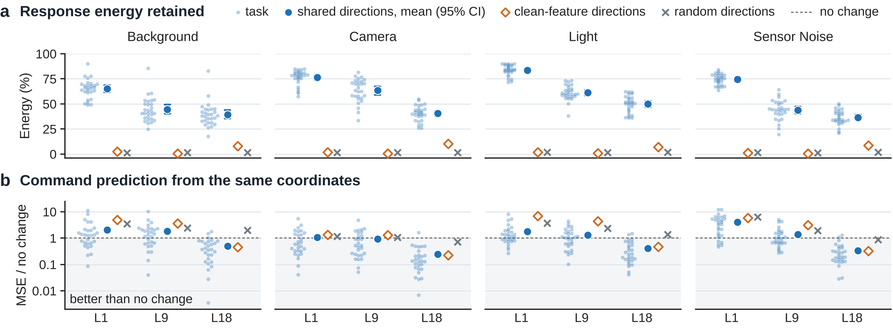
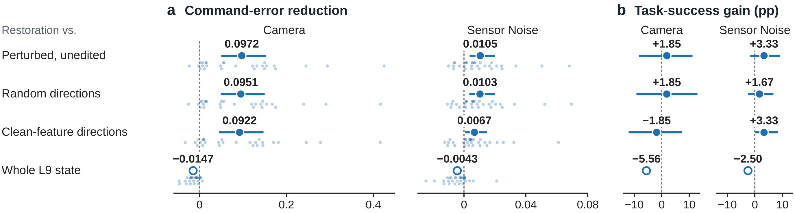
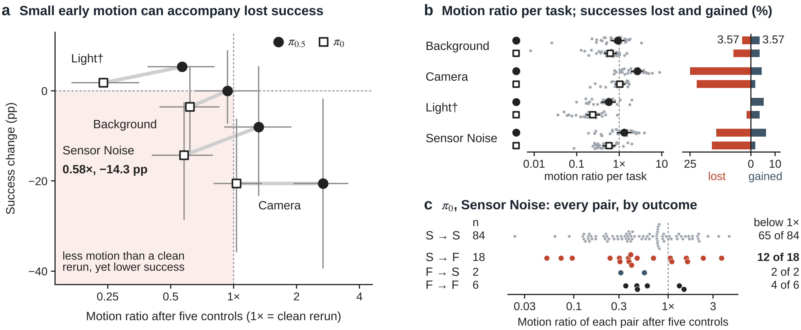

# 《Sensitivity Is Not Fragility》逐图讲解

[论文正文](../../paper1/current/latex/main.pdf) · [组会讲义 PDF](group-meeting-zh.pdf) · [含逐页讲者备注的 PowerPoint](group-meeting-zh.pptx) · [English guide](README.md) · [复现代码与数据](../../reproduce/README.md)

## 图 1　视觉变化在哪里影响动作生成？

沿 **a 图**从左往右看。机器人处在同一个物理状态，两次运行使用相同的策略噪声，只改变它看到的图像。我们在动作专家的第 1、9、18 层分别记录特征，用扰动后的特征减去原始特征。图中 L9 的回路是一次实际干预：生成动作时，沿学到的 16 个方向，把特征坐标恢复到同状态无扰动观测给出的值。

**b 图**给这次干预设了两把尺。以 Camera 为例，恢复后，前五条平移指令与无扰动参照之间的误差下降约 24%。任务成功率的点估计增加 1.85 个百分点，同时 95% 区间为 [−8.33, 11.11]。因此可以清楚地报告指令得到了多大修正；对任务成功收益的估计仍较宽。详细对照见图 4。[论文第 1 页](../../paper1/current/latex/main.pdf) · [组会第 2、7 页](group-meeting-zh.pdf)

## 图 2　每个实验固定了什么，又比较了什么？

先读 **a 图**的两个时间尺度。策略看到图像后，用十次生成更新细化一段动作计划。机器人随后执行前五个控制步，到新位置再观测、再规划。**b 图**在对应的生成步比较两次运行的内部特征；**c 图**每次都在干预分支当时所处的位置取得无扰动视图，作为恢复坐标的参照。

**d 图**解释后文的“1 倍”从哪里来。同一设定下，先配对比较使用相同噪声的无扰动运行和扰动运行，再比较使用两组不同噪声的无扰动运行。后一个距离给出了策略自身重采样的运动尺度。另一次同噪声重复用于检查执行可重复性。对照表 1，可分别找到内部记录、恢复和独立执行各自使用了哪些案例。[论文第 3 页](../../paper1/current/latex/main.pdf) · [组会第 8–9 页](group-meeting-zh.pdf)

## 图 3　怎样描述反复出现的变化？哪一层更适合预测指令？

**a 图**先问：从一些任务和扰动中学到的方向，能描述新的视觉响应吗？方向在训练时确定，测试时将实际观测到的响应投影到这些方向。404 个配对覆盖 28 个任务。在不同层与扰动族的平均结果中，16 个共享方向保留了 **36.5%–83.6%** 的残差能量。小点显示任务之间的差异；从无扰动特征学到的方向和随机方向提供了相同维数的对照。

**b 图**用这些坐标预测前五条平移指令的变化。先找基准线 **1**：低于它，预测误差就小于直接预测“指令保持原样”的误差。四类扰动中，L1 保留的响应能量最多，而本文检验的读出在 L18 的平移预测误差最低。读者关心响应结构还是指令预测，会影响测量层的选择。[论文第 5 页](../../paper1/current/latex/main.pdf) · [组会第 10–11 页](group-meeting-zh.pdf) · [任务级输入](../../reproduce/inputs/)

## 图 4　恢复这 16 个坐标，策略真正发出的指令会怎样变？

每行都拿同一批案例中的两种运行作比较。**a 图**的正值表示共享方向恢复后，发出的指令更接近无扰动指令。与未编辑运行相比，Camera 下的平均误差从 **0.409 降至 0.312**，Sensor Noise 下从 **0.209 降至 0.199**。比较任务间差异时看小点；比较两种扰动时要分别读各自的横轴刻度。

**b 图**把观察对象换成任务成败。两个成功率差分别是 **+1.85、+3.33 个百分点**，同时置信区间都包含零。表 2 还列出各组实际写入的幅度，方便理解不同方向对照。整层替换用空心点标出，不属于原定计算区间的六项比较。仓库提供逐条已发指令、配对结局和归档区间，可从命令向量重算误差，再沿案例编号核对成败。[论文第 6 页](../../paper1/current/latex/main.pdf) · [组会第 12–13 页](group-meeting-zh.pdf) · [恢复实验数据](../../paper1/current/figure_src/raw/restoration/)

## 图 5　机器人移动了多少，能告诉我们会不会失败吗？

在 **a 图**找到 π₀ 的 Sensor Noise 点。第 5 个控制步后，扰动引起的平均末端分离只有无扰动重采样参照的 **0.58 倍**，配对成功率却下降 **14.3 个百分点**。这里先按任务求均值，再计算两种运动距离的比值。

**b 图**解释了为什么还要逐次看结果。π₀.₅ 在 Background 下，原本成功、加扰动后失败的加权比例是 **3.57%**；反过来由失败变成功的比例也是 **3.57%**。成功率净变化为零，实际有 **7.14%** 的配对结果发生翻转。**c 图**把 π₀ 的 110 个 Sensor Noise 配对逐个展开，每个点都用本设定自己的重采样距离作参照。18 个丢失成功的配对中，有 12 个点低于 1 倍。读者可以在这里从总体平均追到具体执行。[论文第 7 页](../../paper1/current/latex/main.pdf) · [组会第 14–15 页](group-meeting-zh.pdf) · [五臂统计代码](../../paper1/current/figure_src/scripts/fig5_data.py)

组会材料保留了 11 月 12 日汇报时的封面副标题和第 17 页待办。当前稿的图号、区间和复现状态以本页链接的正文及复现指南为准。
