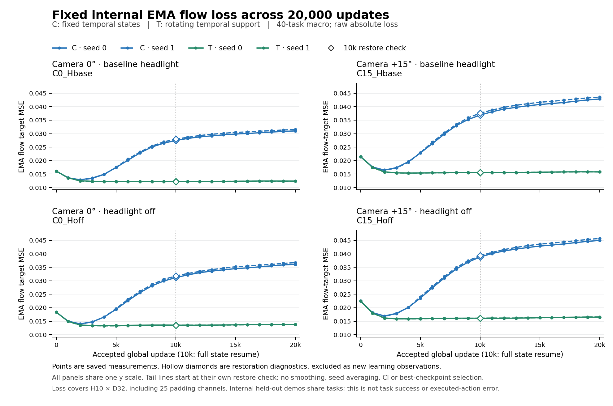
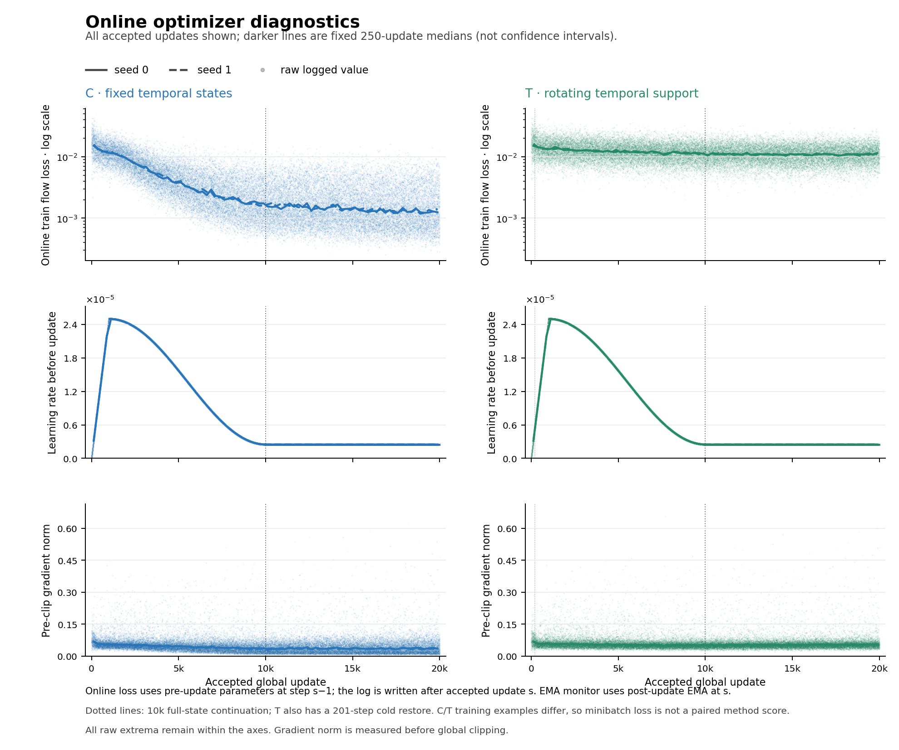

# C/T 训练如何执行，20k 是否足够？

2026-10-19。已在百度纯CPU读取实际训练日志并生成曲线；没有追加训练、模型推理、仿真或评测。四条分支每条都有从1到20000的完整已接受更新记录，T的201步冷恢复与10k续训接缝也连续。全部80,000条更新无重复或缺步；固定EMA监控覆盖0–20k每1000步、4条件、4分支，共336个曲线点，另保留16个恢复核对值。

**2026-10-19重新核对后的判断：T在相同20k预算下具有更低的内部留出误差，但尚未证明T已经充分优化。** 新排程核对显示C每个起点被选中100次，T平均约2.05次；T首次经过完整所选支持时，学习率已降至峰值十分之一。因此，原文用当前留出平台弱化“训练不足”的推断过强，现予以修正。数字与原训练结果不变，最新判断见[优化充分性复核](reassessment-0p001-v1/REPORT.md)。

## 实际训练改变了什么

| 项目 | C：固定时刻 | T：轮换时刻 |
| --- | --- | --- |
| 数据来源 | 原LIBERO四suite、40任务、1600条训练示范 | 相同示范与任务 |
| 训练物理状态 | 每示范固定两个时刻，反复使用 | 每示范两个时间分层，随epoch轮换物理时刻 |
| 一步的输入 | 16个状态各两份clean行，共batch32 | 相同 |
| 输入形式 | 当前时刻双相机图像与任务指令 | 相同，仍非多帧视频输入 |
| 模型与更新范围 | 同一π0.5-LIBERO；冻结视觉/语言前缀，更新动作专家及action/time投影 | 相同 |
| 损失 | 原监督式flow matching MSE，H10×D32全维平均 | 相同 |
| 优化预算 | 10k=50epoch；20k=100epoch，640k行暴露 | 相同 |
| 10k→20k | 全状态恢复，继续固定时刻 | 全状态恢复，第二段重用原50轮时刻排程 |

这里clean表示没有施加本研究的额外环境扰动；原模型普通图像增强、flow噪声和时间采样继续保留。32行对应16个物理状态，不是32条独立示范。T后半段重用已确定的时间支持，增加优化与样本暴露次数，没有再增加一批新的物理时刻。

优化器实际为AdamW：β1=0.9、β2=0.95、ε=1e−8、weight decay=1e−10；全局梯度范数裁剪1.0；EMA=0.999；无梯度累计。前1000步warmup到2.5e−5，再按原日程降到10k附近的2.5e−6；后10k保持该下限。恢复保留optimizer、EMA、RNG、global step和数据游标，没有重置warmup。这是正确的接续方式。

**准确的实验意义是时间覆盖对照。** C20与T20比较同更新预算下覆盖更多示范时刻的作用；同组10k与20k比较在既定数据和目标上继续优化的作用。当前没有PGD、响应引导选择、维度约束或新的一致性loss，因此不能把T的结果称为对抗训练或机制指导训练收益。它可作为未来方法必须超过的时间覆盖基线。

## 两种loss要分开读

[固定EMA内部验证曲线](actual-v1/science/F1_EMA_MONITOR-v1.png)使用400条本轮优化未使用的示范、800个状态、相同40任务。四条件是原生相机0°/+15°与renderer headlight基线/off组合；并非数字RGB。若原headlight基线已经关闭，off可成为无变化条件，原记录保留这一情况。验证使用EMA、固定随机键，保留stock train=True带来的增强与flow随机量；它是内部demo留出，不是未见任务或盲测。

蓝线C在最初下降后持续回升，绿线T在前几千步下降后基本保持平台。两seed方向一致。四面板共用同一纵轴；10k空心菱形是恢复核对，单独显示而不算新的学习点。

[在线优化诊断图](actual-v1/science/F2_OPTIMIZER-v1.png)显示每步实际训练loss、学习率和裁剪前梯度范数。浅点保留全部原记录，深线是预先固定250步分箱的中位数；它不是置信区间。在线loss使用更新前参数，EMA监控使用对应更新后的EMA，不能拼成一条曲线。

## 10k到20k实际发生了什么

下表训练loss取各checkpoint之前1000步的中位数（9001–10000与19001–20000），留出loss取对应checkpoint的EMA固定监控。两种数值来自不同参数视图与样本支持，不能用二者直接相减估计泛化间隙。

| 分支 | 训练loss，10k附近→20k附近 | 基线环境EMA留出loss，10k→20k | 留出loss变化 |
| --- | --- | --- | ---: |
| C · seed 0 | 0.001776 → 0.001240 | 0.027489 → 0.031017 | +12.84% |
| C · seed 1 | 0.001665 → 0.001305 | 0.027965 → 0.031542 | +12.79% |
| T · seed 0 | 0.011411 → 0.011077 | 0.012256 → 0.012404 | +1.21% |
| T · seed 1 | 0.011311 → 0.010978 | 0.012234 → 0.012357 | +1.01% |

C的训练loss继续下降，留出loss却继续恶化：基线条件两seed均约+12.8%，其余相机/灯光条件约+15.5%到+16.2%。这是明显的过拟合表现：对有限训练时刻拟合得更好，并没有改善未用于优化的示范。它不支持把相同配方直接加长视为优先解法；也不能只凭这两条曲线确定背后的唯一神经机制。

T的固定留出loss显著低于C，但10k到20k在四条件、两seed上均小幅上升，幅度约+1.0%到+2.8%。末段19k到20k多数条件略有下降，组合条件seed1略升；这些小波动不能被挑成单方向结论。这只说明原学习率日程下的监控近平台，不能区分优化不足与其它解释。T的训练loss比C高也不能单独判定训练质量：两者训练支持不同，而T每个起点的重复曝光远少于C。

恢复核对与原10k点之间保留了数值差异，最大相对差约0.024%；没有改原值、把两点平均或按较好值取舍。跨C/T的step0小差也原样保留，原因未在这次标量分析中确定。

## 这对下一步意味着什么

1. **先用C/T解释数据支持，而不是把它包装成新训练方法。** 现有内部验证支持：同一批示范中覆盖更广时刻，比反复拟合两个固定时刻更稳妥。这仍需闭环结果限定其实际作用。
2. **将T的优化充分性列为尚未解决的直接问题。** C的留出恶化不能排除T延长训练的价值。后续如验证，应从同一T20完整状态比较原LR与调整后续LR的等预算接续，固定数据支持、loss和可训练参数，并结合固定train probe、内部留出与行为结果；本轮不启动训练。
3. **先把既有成功率收尾分析好。** T20全体仍有1188条未闭合（其中908确认未启动、3技术失败、277待核），且部分10k/20k案例的预热后q0不同，严格配对规则继续保留。现有结果不能证明20k是闭环最优；loss不能替代成功率，也不据此重跑正常成功或失败。
4. **未来记录应增加物理7维与padding25维的loss分项。** 当前整体loss平均H10×D32，包括25个补零动作通道的flow噪声目标。现有日志没有平移/旋转/夹爪分项，不能倒推出这些量，更不能把总loss当机器人执行误差。若以后补充指标，应使用同一模型状态、样本和flow随机量；这是后续记录建议，本轮没有新模型调用。

LIBERO-Plus在本对照中用于训练后的闭环评测，不在训练数据或这套内部loss验证人口中。训练loss、内部原LIBERO诊断与Plus任务表现分别回答优化、内部留出和跨条件行为的问题。

**本轮交付与保存。** 原始356,650,330字节日志只在百度CPU读取；新产物保存在 `redacted-7232fe2d7b52`，包括完整精简更新表、EMA数值、窗口统计、PNG/PDF/SVG和逐对象SHA。Mac只回小摘要与图。作业 `redacted-2690f8b1d47a` 已成功，provider与实例均终态；GPU使用0，JPFS新增0。未改第一篇、科学registry或桥阈值。

数据来源：[实际读出](actual-v1/science/SUMMARY-v1.json)、[云端结果与对象位置](actual-v1/summary/RESULT-v1.json)、[源码及实际训练合同](contract/CONTRACT-AUDIT-v1.md)、[训练数据基准补充](contract/DATA-BENCHMARK-ADDENDUM-v1.md)、[字段与对象盘点](inventory/README.md)。
